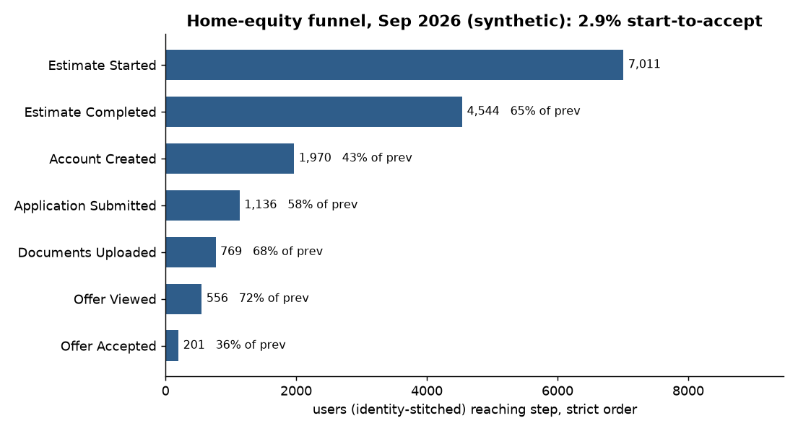
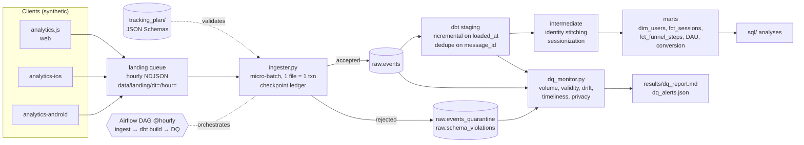
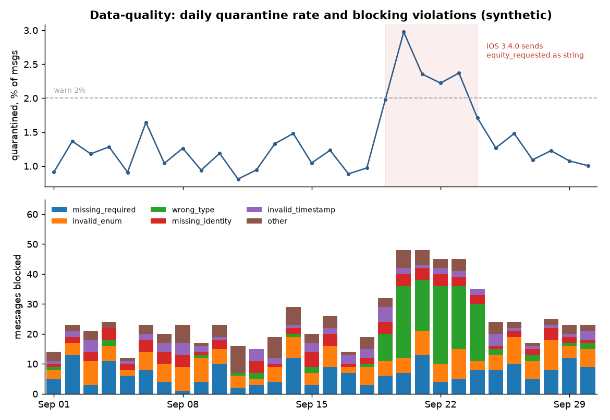
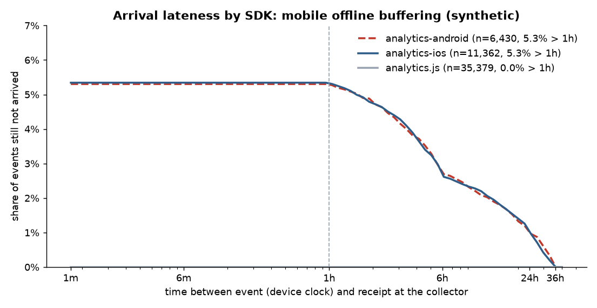

# Product Event Pipeline: tracking plan → validated ingest → dbt → data-quality monitoring

[](https://github.com/kedarnath30/product-event-pipeline/actions/workflows/ci.yml)

**An end-to-end product-analytics event pipeline, the kind that sits behind Segment, Amplitude or RudderStack.** It covers a versioned tracking plan (JSON Schema), a validator that quarantines bad events, an idempotent micro-batch ingester, incremental dbt models with 63 data tests and 1 unit test, a trend-aware data-quality monitor, an Airflow DAG and CI. Everything runs locally for free on DuckDB in under two minutes.

> **All data is synthetic.** A seeded generator simulates 30 days (Sep 2026) of web and mobile events for a fictional home-equity fintech, "Keystone Equity". It also injects the mess real pipelines see: malformed events, PII, SDK-retry duplicates, offline-buffered mobile events, a web tracking outage and a schema-breaking iOS release. Every number below describes that simulation, not a real company.



---

## Architecture



| Layer | What it does | Code |
|---|---|---|
| Tracking plan | 7 funnel `track` events + `identify` + `page`, each a JSON Schema (draft 2020-12) sharing a Segment-spec envelope | `tracking_plan/schemas/` |
| Validator | JSON Schema plus rules a schema can't express: Object-Action naming, PII keys, timestamp sanity (unparseable, future). Each violation gets a stable code and a severity: **block** quarantines the event, **warn** accepts it but logs drift | `src/validator.py` |
| Generator | Seeded simulation of visitors, sessions, funnel drop-off, cross-device identity, and injected failure modes. Writes hourly NDJSON partitioned by `receivedAt`, i.e. a file queue like Firehose → S3 | `src/generator.py` |
| Ingester | Each hourly file is one micro-batch committed in a **single DuckDB transaction together with its checkpoint row**, so a file loads exactly once even after a crash or re-run. Supports `--until` (replay up to an hour) and `--follow` (poll the queue) | `src/ingester.py` |
| dbt | 4 staging, 4 intermediate, 6 mart models. Staging is **incremental on load time** (not event time), so late events land in whichever run loads them. Includes custom generic tests that use the pipeline's own clock (`recency_within`, `daily_volume_within_bounds`), singular tests (funnel monotonic, quarantine rate < 5%, sessions well formed, every account has an identify) and a unit test for the 30-minute session split | `dbt/` |
| DQ monitor | Softer, trend-aware alerts that sit next to the hard dbt gate: volume vs trailing median, hourly per-SDK drops, block rate, per event × app-version rejection spikes, schema drift by first-seen version, completeness, lateness, duplicates, PII | `src/dq_monitor.py` |
| Orchestration | `src/pipeline.py` replays the month end to end. The Airflow DAG runs the same steps hourly | `src/pipeline.py`, `airflow/dags/` |

## How the replay works (and why it matters)

`python -m src.pipeline` replays the stream the way a production schedule would see it:

1. **Generate** the 30-day stream → 720 hourly files, 54,230 delivered messages.
2. **Ingest up to 2026-09-29 00:00 UTC**: 672 micro-batches, 49,906 messages.
3. **`dbt build`** with `pipeline_as_of = 2026-09-29`: 14 models, **63/63 data tests + 1/1 unit test pass**.
4. **Ingest the rest of the queue**: 48 batches, 4,324 messages. These include **24 late mobile events whose event time is before the cut-over** (phones that were offline and flushed hours later).
5. **Incremental `dbt build`** with `pipeline_as_of = 2026-10-01`: staging appends only the 4,250 newly loaded, de-duplicated rows, **all 24 late events included**, and the marts rebuild. 63/63 + 1/1 tests pass again.
6. **DQ monitor → SQL analyses → figures**, then the run summary is written to `results/pipeline_run.json`.

The full run takes about 100 s on a laptop. Re-running the ingester on a loaded warehouse is a no-op: 0 batches, and row counts don't change (covered by tests).

## Results (synthetic month, Sep 2026)

**Pipeline**

| Metric | Value |
|---|---|
| Messages delivered to the queue | 54,230 |
| Accepted → `raw.events` | 53,484 |
| Quarantined (blocking violations) | 746 (**1.38%**) |
| Accepted with a drift warning | 325 |
| SDK-retry duplicates in raw (removed in staging) | 0.59% → 53,171 unique events |
| Events arriving > 1 h late | 1.96% overall; 5.3% of iOS / Android events, 0% on web |
| People (identity-stitched) / sessions | 16,010 / 17,808 |
| dbt | 14 models, 63 data tests + 1 unit test, all pass on both builds |
| DQ alerts | 11 (4 critical, 7 warning) |

**What the monitor caught.** The failure modes were injected blind into the generator. The DQ monitor found every one of them from the warehouse alone:

| Severity | Check | When | Finding |
|---|---|---|---|
| critical | volume | Sep 17, 14:00–21:00 UTC | analytics.js volume down 89% for 7 h (~453 events missing): a collector outage |
| critical | schema drift | Sep 19 18:05 → | iOS 3.4.0 sends `equity_requested` as a string; 113 of 113 `Estimate Completed` events from 3.4.0 were rejected |
| warning | schema drift | Sep 19 → / Sep 24 → | iOS 3.4.0 and 3.4.1 send an unplanned `credit_score_band` (accepted, flagged for the tracking plan) |
| warning | validity | Sep 20–23 | Daily quarantine rate 2.2–3.0%, above the 2% warn line (staged rollout of 3.4.0) |
| warning | schema drift | whole month | 4 off-plan event names quarantined (`clicked_offer`, `OfferViewed`, …) |
| critical | privacy | Sep 6 | `traits.email` sent 3 times; quarantined, never loaded |



The iOS bug had a business cost as well as a data cost. On Sep 22–23, **65–68% of iOS `Estimate Completed` events never reached the warehouse** (`results/sql_03_ios_release_impact.csv`). Any iOS funnel dashboard would have shown a fake conversion drop until 3.4.1 shipped.

**Late data is a mobile problem.** Web events arrive within about 2 s (p95). About 5.3% of app events arrive more than 1 h late, and some up to 36 h late, because phones buffer events while offline. This is why staging is incremental on `loaded_at` rather than `event_ts`, and why `fct_daily_conversion` flags cohorts younger than 14 days as immature.



**Funnel** (identity-stitched, strict step order, all sources): 7,011 people started an estimate. Of those, 64.8% completed it, 28.1% created an account, 16.2% applied, 11.0% uploaded documents, 7.9% viewed an offer and **2.9% accepted one** (201 people). The weakest segment is mobile web, at 0.9% start-to-accept vs 3.7–3.8% on desktop and iOS (documents are hard to upload from a phone browser). The strongest source is `partner_lender`, with 8.5% of its sessions reaching an application vs about 4% for paid search. See `results/sql_0*.csv`.

## Run it

```bash
python -m venv .venv && source .venv/bin/activate
pip install -r requirements.txt
make pipeline      # = python -m src.pipeline  (generate → ingest → dbt → late data → incremental dbt → DQ → SQL → figures)
make test          # pytest: validator, generator, ingester idempotency, Airflow DAG
```

Individual steps: `make generate`, `make ingest-partial`, `make ingest`, `make dbt-build`, `make dq`, `make sql`, `make figures`. For dbt by hand, run `cd dbt && PEP_DUCKDB_PATH=$PWD/../warehouse/events.duckdb dbt build --profiles-dir .`. Near-real-time mode: `python -m src.ingester --follow`.

**Airflow.** `airflow/dags/product_event_pipeline.py` runs hourly: `ingest_micro_batches → dbt_build → dq_monitor`. It uses `max_active_runs=1` (one writer on the DuckDB file) and passes the run's `data_interval_end` to dbt as the pipeline clock, so freshness tests are deterministic on backfills. Set `PEP_PROJECT_DIR` on the workers.

**CI** (`.github/workflows/ci.yml`) has two jobs. The first lints, runs pytest, runs the full pipeline (which fails if any dbt test fails) and uploads results and figures. The second imports the DAG against real Airflow 2.10.

## Tests

- **pytest (23 tests):** validator accept / block / warn paths for every violation code; generator determinism, right-censoring at the stream clock and partitioning; ingester idempotency (re-run is a no-op), partial-then-resume equals full load, unparseable lines quarantined; DAG import and wiring with a stubbed `airflow` package.
- **dbt (63 data tests + 1 unit test):** keys, accepted values and relationships; source freshness and volume against the pipeline clock; funnel monotonicity; quarantine-rate gate; session sanity; identify coverage; and the 30-minute sessionization unit test.

## Repo layout

```
tracking_plan/schemas/   JSON Schemas (envelope, identify, page, 7 track events)
src/                     generator, validator, ingester, dq_monitor, run_sql, figures, pipeline
dbt/                     staging → intermediate → marts, macros, generic + singular tests
sql/                     analysis queries (funnel by device, time to convert, iOS impact, lateness, sources)
airflow/dags/            hourly DAG
tests/                   pytest suite
results/                 pipeline_run.json, dq_report.md, dq_alerts.json, dq_daily_metrics.csv, sql_*.csv
figures/                 PNGs used above
```

Generated, git-ignored: `data/landing/`, `warehouse/`, `dbt/target/`, `dbt/logs/`.

## Design notes

- **Quarantine, don't drop.** Rejected events keep their payload and violation codes, so a fixed client can be replayed and every rejection can be explained.
- **Block vs warn.** An unplanned property is drift worth seeing, not a reason to lose an otherwise valid event. A wrong type or a missing required field breaks downstream models, so it blocks.
- **Two clocks.** Event time drives analytics; load time drives incrementality. Tests use an explicit `pipeline_as_of` var instead of `now()`, so backfills and CI are reproducible.
- **At-least-once raw, exactly-once per file.** The checkpoint ledger stops a file from loading twice. SDK retries (same `messageId`) are expected in raw, and staging removes them.

## License

MIT. See [LICENSE](LICENSE). Built by Kedarnath Pandiri.
